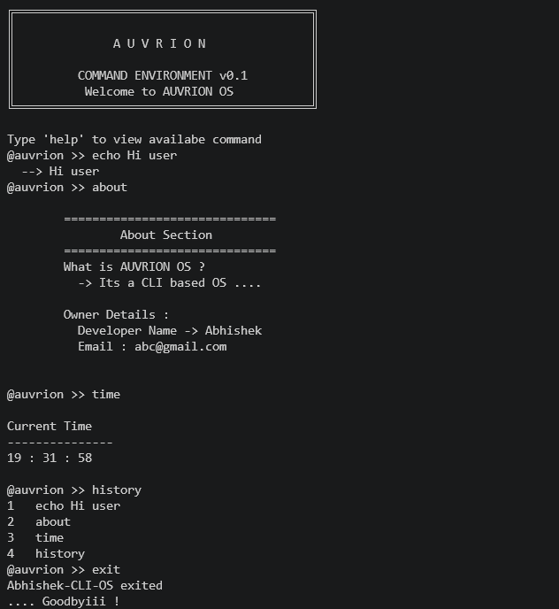
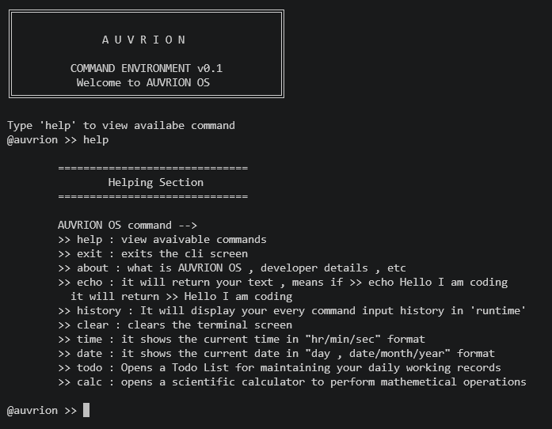
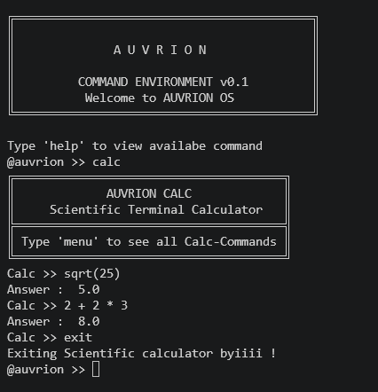
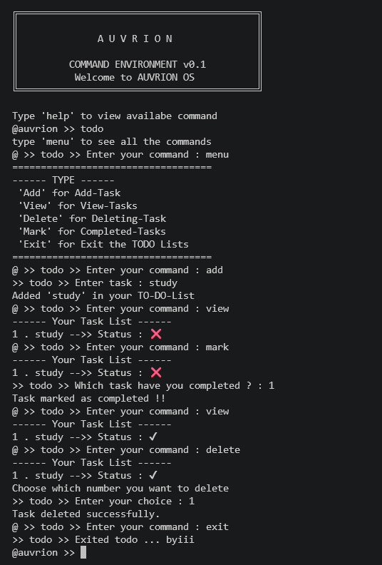

# AUVRION

AUVRION is a Python-based command-line interface project designed to provide a simple terminal environment with useful built-in utilities.

## Features

- **Command System:** Execute commands through a custom CLI.
- **Scientific Calculator:** Perform mathematical calculations using infix-to-postfix conversion and postfix evaluation.
- **To-Do List:** Add, view, delete and manage tasks.
- **Date and Time:** Display current date and time.
- **Command History:** View previously entered commands.
- **System Utilities:** Clear the terminal, display uptime and more.

## Project Structure

```text
AUVRION/
│
├── main.py
├── calc.py
├── To_Do_List.py
├── README.md
└── .gitignore
```
## Screenshots

### 1. Working


### 2. Commands


### 3. Scientific Calculator


### 4. To do List


## Requirements

- Python 3.x
- Windows, Linux or macOS terminal

## How to Run

1. Clone or download this repository.
2. Open the project folder in a terminal.
3. Run:

```bash
python main.py
```

## Technologies Used

- Python
- Python Standard Library

## Project Status

Currently under development. More features and improvements will be added in future versions.

## Author

Abhishek Choudhary